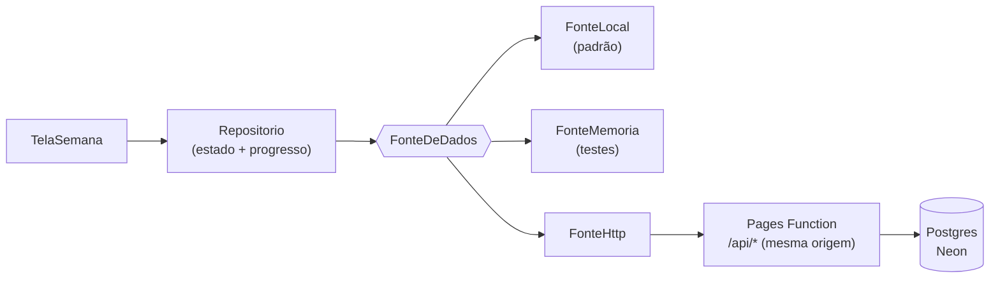

# Minha Semana

Planejador semanal em Flutter, a partir do `Minha Semana.html`. O plano é
**editável**: cada dia aceita criar, editar e excluir atividades, com horário e
duração próprios. O progresso fica salvo. Funciona **sem conta** (estado no aparelho) e, com a API
publicada, **sincroniza na nuvem** entre aparelhos.

| Projeto | O que é | Plataformas |
| --- | --- | --- |
| [`planner`](planner/) | O aplicativo: semana, timeline, cômodos, ajustes e login | Web, Android, iOS |
| [`pacotes/planner_core`](pacotes/planner_core/) | Template da semana, contrato de fonte, fachada e telemetria (sem UI) | — |
| [`pacotes/planner_ui`](pacotes/planner_ui/) | Primitivas visuais neutras, com paleta injetada | — |
| [`api`](api/) | API sobre o Postgres: sessão, estado da semana, eventos (Pages Function) | — |
| [`deploy`](deploy/) | Schema do banco e provisionamento | — |
| [`e2e`](e2e/) | Testes de ponta a ponta em Chromium real (API + interface) | — |

## Por onde começar

- **Entender a arquitetura:** [`docs/ARQUITETURA.md`](docs/ARQUITETURA.md)
- **Rodar tudo localmente:** `python ferramentas/servir.py`
- **Testar:** `flutter test` em `pacotes/planner_core` e `planner`; `npm test` em `api`
- **Testar de ponta a ponta:** `cd e2e && npm install && npx playwright install chromium && npm test` (ver [`e2e/README.md`](e2e/README.md))

## Estado atual

Publicado e lendo do Postgres.

| Recurso | URL |
| --- | --- |
| Aplicativo e API | https://minhasemana.pages.dev (`/api/*` é a API) |

O app é compilado com `PLANNER_FONTE=http` e `PLANNER_API=/api`. App e API são o
mesmo projeto Cloudflare Pages, servidos na mesma origem — o cookie de sessão é
`SameSite=Strict` e não atravessa host diferente.

Sem argumentos de build, o app usa o armazenamento do aparelho. O template não
fica no banco: ele é compilado no app, então mudar a rotina não exige migração.

**Escrita exige login.** O plano é pessoal: nem a leitura da semana é pública.

**O plano é dado, não código.** O que vem do HTML é só a semente da primeira
abertura; dali em diante, criar/editar/excluir atividades é operação de tela.

### Segurança

| Item | Como está |
| --- | --- |
| Senha | PBKDF2-HMAC-SHA256, 100 mil iterações (teto da Cloudflare) sobre `HMAC(senha, pepper)` |
| Sessão | cookie `HttpOnly` + `Secure` + `SameSite=Strict` assinado, 8 h |
| Inatividade | 1 h sem uso encerra a sessão (servidor e interface, com aviso) |
| Força bruta | 5 tentativas por IP/usuário em 15 min; IP guardado como hash |
| Entrada | corpo ≤ 1 MiB, listas ≤ 500 itens, textos truncados, IDs validados |
| Erro | mensagem do banco nunca vai ao cliente; log com `x-erro-id` |
| Cabeçalhos | HSTS, CSP, `X-Frame-Options`, `nosniff`, `Referrer-Policy` |
| CORS | allowlist exata, sem `*` |
| Hospedagem | Cloudflare Pages: app e API na mesma origem, um deploy |

Detalhes e o porquê de cada escolha em
[`docs/ARQUITETURA.md`](docs/ARQUITETURA.md#segurança).

## Como os dados fluem



Trocar de fonte é recompilar, não reescrever tela:

```bash
# estado no aparelho (padrão)
flutter build web --release

# nuvem
flutter build web --release \
  --dart-define=PLANNER_FONTE=http \
  --dart-define=PLANNER_API=/api \
  --dart-define=PLANNER_ANALYTICS=http
```

| Define | Padrão | Uso |
| --- | --- | --- |
| `PLANNER_FONTE` | `local` | `local`, `memoria` ou `http` |
| `PLANNER_API` | vazio | raiz da API (obrigatório com `http`) |
| `PLANNER_ANALYTICS` | `memoria` | `memoria`, `http`, `console`, `nulo` |
| `PLANNER_INATIVIDADE_SEGUNDOS` | `3600` | encurta o teste de inatividade |

## Verificação

```bash
cd pacotes/planner_core && flutter analyze && flutter test
cd planner            && flutter analyze && flutter test
cd api        && npm test
```
