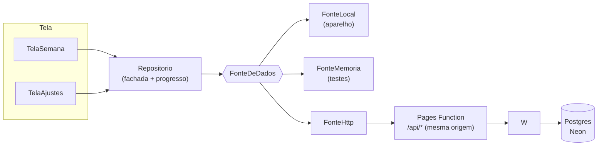

# Minha Semana — arquitetura

Um aplicativo Flutter, dois pacotes Dart puros o suficiente para serem testados
sem tela, e uma API. A regra que organiza tudo: **a tela não conhece a origem
dos dados**.

```
minha-semana/
├── pacotes/planner_core/   template da semana, contrato, fachada, telemetria
├── pacotes/planner_ui/     primitivas visuais neutras (paleta injetada)
├── planner/                o aplicativo + proxy /api (web, Android, iOS)
├── api/                    API sobre o Neon (auth, validação, autorização)
└── deploy/                 schema.sql e provisionamento
```

## Como os dados fluem



App e API são o mesmo projeto Pages, servidos na mesma origem: a Function em
`planner/functions/api/[[caminho]].js` encaminha `/api/*` para `api/src`.

A mesma origem não é decoração: o cookie de sessão é `SameSite=Strict`, e o
navegador **não o envia** quando app e API estão em hosts diferentes. Chamar a
API direto funcionava para leitura pública e silenciosamente devolvia sessão
vazia — na prática, o app parecia logado e não persistia nada.

## O contrato

Toda origem implementa:

```dart
abstract interface class FonteDeDados {
  String get descricao;      // exibido em Ajustes
  bool get permiteEscrita;
  bool get remota;           // o estado está fora do aparelho?
  Future<EstadoSemana> carregar();
  Future<EstadoSemana> salvar(EstadoSemana estado);        // carga em lote
  Future<void> definirAtividade(String id, {required bool concluida});
  Future<void> limparMarcacoes();
  Future<void> salvarComodo(Comodo comodo);
  Future<void> removerComodo(String id);
}
```

Gravar **por entidade** (`definirConcluida`, `salvarAtividade`) e não "a semana
inteira" é o que permite dois aparelhos mexerem em coisas diferentes sem um
apagar o outro. Os testes provam: dois `Repositorio` sobre a mesma fonte, cada um
marcando/editando uma atividade, e as duas alterações sobrevivem.

### Duas camadas de edição, e por quê

| Operação | Contrato | Rota |
| --- | --- | --- |
| marcar/desmarcar numa data | `definirConcluida(data, id)` | `PUT /atividades/:data/:id` |
| criar/editar atividade | `salvarAtividade` | `PUT /dias/:dia/atividades/:id` |
| excluir atividade | `removerAtividade` | `DELETE /dias/:dia/atividades/:id` |
| desmarcar a semana | `limparMarcacoes(segunda)` | `DELETE /atividades?inicio=AAAA-MM-DD` |
| importar backup | `salvar` | `PUT /semana` |

A separação entre "marcação" e "plano" é intencional: marcar é a ação frequente e
não muda o plano; editar é raro e muda o que existe. Uma rota só para as duas
faria cada clique de checkbox carregar título, duração e categoria.

`GravacaoGranular` (mixin) implementa esses métodos para fontes simples
(`FonteLocal`, `FonteMemoria`) compondo sobre `salvar`. `FonteHttp` sobrescreve
todos e fala uma rota por operação.

### O que se persiste

O plano (template), as marcações **por data** e os cômodos:

```json
{
  "versao": 4,
  "concluidas": {
    "2026-10-21": ["qua-09:00", "qua-13:30"],
    "2026-10-22": ["qui-11:00"]
  },
  "comodos": [{ "id": "cozinha", "nome": "Cozinha", "concluido": true }],
  "dias": [
    {
      "chave": "qua",
      "atividades": [
        { "id": "qua-09:00", "dia": "qua", "horario": "09:00", "titulo": "Reorganização",
          "duracaoMinutos": 210, "categoria": "casa", "prioridade": true }
      ]
    }
  ]
}
```

**O plano é dado do usuário.** Criar, editar (horário, duração, título,
detalhe, categoria, flags) e excluir atividades são operações de tela, não
mudanças de código. `dados_semana.dart` virou apenas a semente: o que a primeira
abertura mostra, e o ponto de partida para estados antigos (v2/v3), que não
tinham `dias`.

### Duas dimensões de tempo

| Dimensão | Onde vive | O que significa |
| --- | --- | --- |
| dia da semana (`seg`…`dom`) | template (`dias`) | a rotina que se repete |
| data (`2026-10-21`) | marcações (`concluidas`) | o que foi feito naquele dia |

Sem essa separação, marcar uma quarta marcaria todas as quartas — e "navegar
por semanas" não teria o que mostrar de diferente. A `Agenda` cruza as duas:
recebe uma data, calcula a semana (segunda a domingo) e responde progresso por
dia e da semana. Nada é copiado: os dias apontam para o mesmo template.

O formato v4 trouxe a data. Estados v2/v3 (marcações sem data) **não são
adivinhados**: as marcações antigas são descartadas e o template é preservado.
Atribuí-las a um dia seria inventar informação.

### Conflitos de horário

`Conflitos` (`conflitos.dart`) é **Dart puro** e derivado: recebe as atividades de
um dia e devolve os pares que se sobrepõem. Não é estado, não vai para o banco e
não bloqueia nada.

| Situação | Conflito? |
| --- | --- |
| 06:00 + 10 min × 06:10 | não — termina exatamente no início |
| 06:00 + 25 min × 06:10 | **sim** — 15 min em comum |
| 06:00 + 25 min × 06:10 (sem duração) | **sim** — o instante cai dentro |
| 06:00 sem duração × 06:00 sem duração | não — não ocupam tempo |
| 09:00 + 3h × 10:00 | **sim** |

O intervalo é semiaberto (`[início, fim)`), mas um item pontual conta no início
também: dois compromissos às 06:00 se chocam. É a regra que faz o template
original — blocos encaixados um no fim do outro — não acusar conflito nenhum.

A tela usa `Repositorio.conflitosDoDia` (mapa id → conflitos) e o editor usa
`Conflitos.deAtividade` com a atividade **como está no formulário**, então o
aviso acompanha a digitação. Em nenhum caminho a gravação é recusada por
conflito.

### Navegação

| Rota | O que abre |
| --- | --- |
| `/semana` | semana de hoje |
| `/semana/2026-10-21` | semana daquela data, com aquele dia aberto |
| `/dia/qua` | a próxima quarta da semana aberta (link antigo) |
| `/calendario` | mês + prancha dos sete dias |

A data na URL é o que faz recarregar a página manter a semana e o link ser
compartilhável. `TelaSemana` avisa o roteador (`context.replace`) a cada
mudança, então o endereço nunca mente sobre o que está na tela.

O ID de uma atividade é opaco e **não** muda ao editar — `seg-06:00` na
criação, com sufixo (`seg-06:00-2`) quando o par dia/horário já está ocupado. É
o que faz a marcação sobreviver a mudar o horário: a identidade é o id, não o
horário.

## O template

`construirSemana()` reproduz o HTML original linha a linha:

| Dia | Particularidade |
| --- | --- |
| Segunda / quarta | dia inteiro de reorganização (3h30 + 4h) |
| Terça / quinta | academia de manhã, pilates às 15h, reorganização nos vãos |
| Sexta | academia e tarde longa (4h) para fechar a semana |
| Sábado | limpeza completa no lugar da aula; reorganização o resto do dia |
| Domingo | reorganização de manhã, descanso e planejamento à tarde |

Todos os dias acordam às 6h e dormem às 22h. Os testes do núcleo travam essas
regras (ordem cronológica, IDs únicos, academia/pilates como compromisso fixo).

## Progresso

`Semana` calcula tudo — não há `reduce` em widget:

```dart
int get totalFeitas;      // marcações que existem no template
double get progresso;     // 0..1
int get percentual;       // 0..100, o "0%" do cabeçalho
int feitasNoDia(Dia d);   // o "0/14" das abas
```

Marcações de IDs que não existem mais são ignoradas na conta (e descartadas na
próxima gravação), então remover uma atividade do template não corrompe o
percentual.

## Escrita otimista

`Repositorio._aplicar` faz, nesta ordem:

1. transforma o estado local e notifica (o checkbox responde no mesmo frame);
2. persiste na fonte;
3. **só então** registra o evento de telemetria.

Se a persistência falhar, `erro` é preenchido e a tela mostra a faixa — mas a
marcação local **não** é revertida: perder o que a usuária acabou de fazer seria
pior que mostrar um erro. Há teste para os dois lados:

- falha de gravação mantém a marcação local e preenche `erro`;
- falha de gravação **não** gera evento `atividade_concluida`.

## Analytics

O evento é genérico (`nome` livre + `propriedades` + `valor`), então instrumentar
um domínio novo não pede migração:

```dart
analytics.registrar('atividade_concluida',
  propriedades: {'atividade': 'Acordar', 'dia': 'seg'},
  entidade: 'atividade', entidadeId: 'seg-06:00');
```

| Destino | Quando |
| --- | --- |
| `ColetorMemoria` | padrão (só a sessão do navegador) |
| `ColetorHttp` | `PLANNER_ANALYTICS=http` → `POST /eventos` |
| `ColetorConsole` | depuração |
| `ColetorNulo` | desligado |
| `ColetorComposto` | memória **e** HTTP |

`registrar` nunca lança: há teste com um coletor que sempre explode, provando que
`marcar` continua funcionando.

`Analise` é Dart puro (por dia, sessões, duração média, frequências, somas,
percentual), e existe para que as telas não repitam cálculo de apresentação.

## Segurança

Modelo em uma frase: **o plano é pessoal; leitura e escrita exigem sessão**.

| Camada | Decisão |
| --- | --- |
| Senha | PBKDF2-HMAC-SHA256, 100 mil iterações (teto do runtime da Cloudflare) sobre `HMAC(senha, pepper)`. Sem o pepper, um dump do banco não permite ataque offline |
| Sessão | cookie `HttpOnly` + `Secure` + `SameSite=Strict` assinado com HMAC-SHA256 (`SESSION_SECRET`), validade de 8 h |
| Inatividade | 1 h sem requisição encerra a sessão; o cookie carrega o último uso e é reemitido a cada uso real (no máximo 1x/min) |
| CSRF | `SameSite=Strict` + JSON obrigatório + `Origin` conferida |
| Autorização | papel lido de `usuario_quadros` a cada requisição |
| Força bruta | 5 falhas por IP e por usuário em 15 min; IP guardado como hash |
| Entrada | corpo ≤ 1 MiB, listas ≤ 500 itens, textos truncados, IDs restritos a `[\p{L}\p{N}_.:-]` |
| Erro | mensagem do banco nunca vai para o cliente; log com `x-erro-id` |
| Cabeçalhos | HSTS, CSP, `X-Frame-Options: DENY`, `nosniff`, `Referrer-Policy`, `Permissions-Policy` |
| CORS | allowlist exata, sem curinga, com credenciais |

### O que o app **não** faz

- Não guarda token em `localStorage`: a sessão é um cookie invisível a scripts.
- Não põe segredo em `--dart-define`: tudo ali vai para o JavaScript publicado.
- Não confia no papel vindo do cliente: o servidor o lê do banco.

## Configuração por compilação

| Define | Padrão | Uso |
| --- | --- | --- |
| `PLANNER_FONTE` | `local` | `local`, `memoria`, `http` |
| `PLANNER_API` | vazio | raiz da API; `/api` em produção (mesma origem) |
| `PLANNER_TOKEN` | vazio | token de serviço (máquina-a-máquina) |
| `PLANNER_ANALYTICS` | `memoria` | `memoria`, `http`, `console`, `nulo` |
| `PLANNER_API_EVENTOS` | `PLANNER_API` | raiz da API de eventos |
| `PLANNER_INATIVIDADE_SEGUNDOS` | `3600` | encurta o teste de inatividade |

## Verificação

```bash
cd pacotes/planner_core && flutter analyze && flutter test
cd planner            && flutter analyze && flutter test
cd api                && npm test
cd e2e                && npm test   # contra o site publicado
```

O `e2e/` é a única suíte que exercita o que só existe em produção: a Function do
Pages, o cookie `SameSite=Strict`, a árvore de semântica do Flutter no navegador
e o Postgres real. Ele também é o teste de contrato do que o app espera da API —
foi ele que pegou os dias vindo sem nome.
