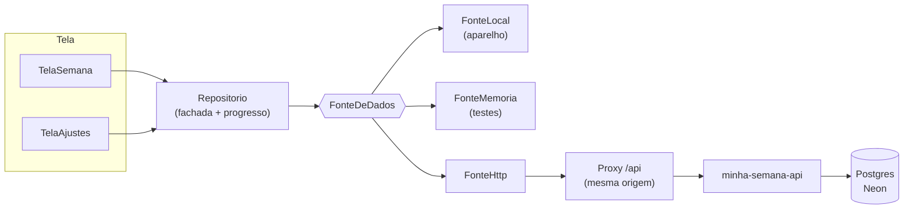

# Minha Semana — arquitetura

Um aplicativo Flutter, dois pacotes Dart puros o suficiente para serem testados
sem tela, e uma API. A regra que organiza tudo: **a tela não conhece a origem
dos dados**.

```
minha-semana/
├── pacotes/planner_core/   template da semana, contrato, fachada, telemetria
├── pacotes/planner_ui/     primitivas visuais neutras (paleta injetada)
├── planner/                o aplicativo + proxy /api (web, Android, iOS)
├── workers/api/            API sobre o Neon (auth, validação, autorização)
└── deploy/                 schema.sql e provisionamento
```

## Como os dados fluem



O proxy de mesma origem não é decoração: o cookie de sessão é `SameSite=Strict`,
e o navegador **não o envia** quando app e API estão em hosts diferentes.
Chamar a API direto funcionava para leitura pública e silenciosamente devolvia
sessão vazia — na prática, o app parecia logado e não persistia nada.

## O contrato

Toda origem implementa:

```dart
abstract interface class FonteDeDados {
  String get descricao;      // exibido em Ajustes
  bool get permiteEscrita;
  bool get remota;           // o estado está fora do aparelho?
  Future<EstadoSemana> carregar();
  Future<EstadoSemana> salvar(EstadoSemana estado);        // carga em lote
  Future<void> definirAtividade(String id, {required bool concluida});
  Future<void> limparMarcacoes();
  Future<void> salvarComodo(Comodo comodo);
  Future<void> removerComodo(String id);
}
```

Gravar **por atividade** (`definirAtividade`) e não "a semana inteira" é o que
permite dois aparelhos marcarem coisas diferentes sem um apagar o outro. O teste
`gravação por entidade` no núcleo prova exatamente isso: dois `Repositorio` sobre
a mesma fonte, cada um marcando uma atividade, e as duas marcações sobrevivem.

`GravacaoGranular` (mixin) implementa esses métodos para fontes simples
(`FonteLocal`, `FonteMemoria`) compondo sobre `salvar`. `FonteHttp` sobrescreve
todos e fala uma rota por operação.

### O que se persiste

Só o que a usuária fez:

```json
{
  "versao": 2,
  "marcadas": ["qua-09:00", "dom-22:00"],
  "comodos": [{ "id": "cozinha", "nome": "Cozinha", "concluido": true }]
}
```

O **template** (quais atividades existem, em que horário, com que categoria) é
compilado em `dados_semana.dart`. Mudar a rotina é mudar código, não migrar
dados. E o ID de uma atividade é `dia-horário` (`seg-06:00`), não o índice:
inserir uma atividade nova não remarca as outras.

## O template

`construirSemana()` reproduz o HTML original linha a linha:

| Dia | Particularidade |
| --- | --- |
| Segunda / quarta | dia inteiro de reorganização (3h30 + 4h) |
| Terça / quinta | academia de manhã, pilates às 15h, reorganização nos vãos |
| Sexta | academia e tarde longa (4h) para fechar a semana |
| Sábado | limpeza completa no lugar da aula; reorganização o resto do dia |
| Domingo | reorganização de manhã, descanso e planejamento à tarde |

Todos os dias acordam às 6h e dormem às 22h. Os testes do núcleo travam essas
regras (ordem cronológica, IDs únicos, academia/pilates como compromisso fixo).

## Progresso

`Semana` calcula tudo — não há `reduce` em widget:

```dart
int get totalFeitas;      // marcações que existem no template
double get progresso;     // 0..1
int get percentual;       // 0..100, o "0%" do cabeçalho
int feitasNoDia(Dia d);   // o "0/14" das abas
```

Marcações de IDs que não existem mais são ignoradas na conta (e descartadas na
próxima gravação), então remover uma atividade do template não corrompe o
percentual.

## Escrita otimista

`Repositorio._aplicar` faz, nesta ordem:

1. transforma o estado local e notifica (o checkbox responde no mesmo frame);
2. persiste na fonte;
3. **só então** registra o evento de telemetria.

Se a persistência falhar, `erro` é preenchido e a tela mostra a faixa — mas a
marcação local **não** é revertida: perder o que a usuária acabou de fazer seria
pior que mostrar um erro. Há teste para os dois lados:

- falha de gravação mantém a marcação local e preenche `erro`;
- falha de gravação **não** gera evento `atividade_concluida`.

## Analytics

O evento é genérico (`nome` livre + `propriedades` + `valor`), então instrumentar
um domínio novo não pede migração:

```dart
analytics.registrar('atividade_concluida',
  propriedades: {'atividade': 'Acordar', 'dia': 'seg'},
  entidade: 'atividade', entidadeId: 'seg-06:00');
```

| Destino | Quando |
| --- | --- |
| `ColetorMemoria` | padrão (só a sessão do navegador) |
| `ColetorHttp` | `PLANNER_ANALYTICS=http` → `POST /eventos` |
| `ColetorConsole` | depuração |
| `ColetorNulo` | desligado |
| `ColetorComposto` | memória **e** HTTP |

`registrar` nunca lança: há teste com um coletor que sempre explode, provando que
`marcar` continua funcionando.

`Analise` é Dart puro (por dia, sessões, duração média, frequências, somas,
percentual), e existe para que as telas não repitam cálculo de apresentação.

## Segurança

Modelo em uma frase: **o plano é pessoal; leitura e escrita exigem sessão**.

| Camada | Decisão |
| --- | --- |
| Senha | PBKDF2-HMAC-SHA256, 100 mil iterações (teto do runtime da Cloudflare) sobre `HMAC(senha, pepper)`. Sem o pepper, um dump do banco não permite ataque offline |
| Sessão | cookie `HttpOnly` + `Secure` + `SameSite=Strict` assinado com HMAC-SHA256 (`SESSION_SECRET`), validade de 8 h |
| Inatividade | 1 h sem requisição encerra a sessão; o cookie carrega o último uso e é reemitido a cada uso real (no máximo 1x/min) |
| CSRF | `SameSite=Strict` + JSON obrigatório + `Origin` conferida |
| Autorização | papel lido de `usuario_quadros` a cada requisição |
| Força bruta | 5 falhas por IP e por usuário em 15 min; IP guardado como hash |
| Entrada | corpo ≤ 1 MiB, listas ≤ 500 itens, textos truncados, IDs restritos a `[\p{L}\p{N}_.:-]` |
| Erro | mensagem do banco nunca vai para o cliente; log com `x-erro-id` |
| Cabeçalhos | HSTS, CSP, `X-Frame-Options: DENY`, `nosniff`, `Referrer-Policy`, `Permissions-Policy` |
| CORS | allowlist exata, sem curinga, com credenciais |

### O que o app **não** faz

- Não guarda token em `localStorage`: a sessão é um cookie invisível a scripts.
- Não põe segredo em `--dart-define`: tudo ali vai para o JavaScript publicado.
- Não confia no papel vindo do cliente: o servidor o lê do banco.

## Configuração por compilação

| Define | Padrão | Uso |
| --- | --- | --- |
| `PLANNER_FONTE` | `local` | `local`, `memoria`, `http` |
| `PLANNER_API` | vazio | raiz da API; `/api` é obrigatório em produção |
| `PLANNER_TOKEN` | vazio | token de serviço (máquina-a-máquina) |
| `PLANNER_ANALYTICS` | `memoria` | `memoria`, `http`, `console`, `nulo` |
| `PLANNER_API_EVENTOS` | `PLANNER_API` | raiz da API de eventos |
| `PLANNER_INATIVIDADE_SEGUNDOS` | `3600` | encurta o teste de inatividade |

## Verificação

```bash
cd pacotes/planner_core && flutter analyze && flutter test
cd planner            && flutter analyze && flutter test
cd workers/api        && npm test
```
