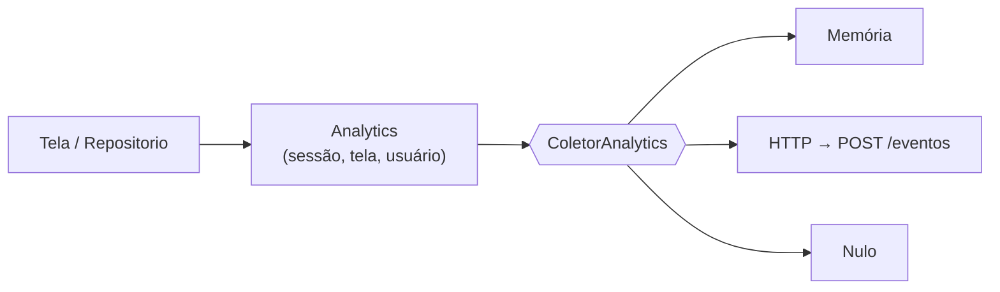

# Auditoria de modularidade

Pergunta: o código é modular "em outros aspectos também, como analytics?"

Resposta curta: **em domínio, dados e telemetria, sim. Em UI, parcialmente — de
propósito.** A separação existe onde importa para trocar infraestrutura; falta
onde causaria cerimônia sem retorno.

---

## 1. O que está modular (e bem)

| Módulo | Onde | Por que está certo |
| --- | --- | --- |
| **Domínio** | `modelos.dart`, `dados_semana.dart` | Dart puro, sem Flutter, com serialização tolerante |
| **Fonte de dados** | `fonte_dados.dart` + 3 implementações | trocar aparelho por nuvem não toca em tela |
| **Fachada** | `repositorio.dart` | as telas falam uma API só; escrita otimista + erro |
| **Evento** | `analytics/evento.dart` | puro Dart, esquema livre |
| **Coletores** | `analytics/coletor.dart` | memória, HTTP, console, nulo, composto |
| **Análise** | `analytics/analise.dart` | **puro Dart**, funções puras |
| **Primitivas visuais** | `pacotes/planner_ui` | estrutura compartilhada, aparência injetada |

O padrão se repete duas vezes:

```
Contrato (interface)  →  implementações  →  fachada  →  telas
FonteDeDados          →  local/memória/http   Repositorio
ColetorAnalytics      →  memória/http/...     Analytics
```

## 2. Por que o analytics é modular de verdade

O caminho natural de um evento é:



Trocar o destino é recompilar, não reescrever chamadas:

```bash
--dart-define=PLANNER_ANALYTICS=memoria   # padrão
--dart-define=PLANNER_ANALYTICS=console   # depuração
--dart-define=PLANNER_ANALYTICS=nulo      # desligado
--dart-define=PLANNER_ANALYTICS=http      # para a API
```

E o contrato é explícito quanto a falha: `registrar` nunca lança. Há teste com um
coletor que sempre explode, provando que a marcação de atividade continua
funcionando.

`Analise` não importa Flutter, não conhece HTTP e não conhece widget: recebe
`List<EventoAnalitico>` e devolve agregados. O mesmo cálculo rodaria num teste,
no app ou num backend Dart.

## 3. O que **não** está modular (e por quê)

### 3.1 O domínio ainda importa `flutter/foundation.dart`

| Arquivo | Usa | Consequência |
| --- | --- | --- |
| `repositorio.dart` | `ChangeNotifier` | não roda em Dart puro |
| `analytics/analytics.dart` | `ChangeNotifier`, `debugPrint` | idem |
| `analytics/coletor.dart` | `debugPrint` | idem |

O `modelo`, o `template` e a `Analise` **são** Dart puro. O que falta é trocar
`ChangeNotifier` por um observável mínimo. O gatilho para fazer isso é um
consumidor real em servidor — hoje seria abstração sem uso.

### 3.2 A paleta de categorias exige tradução no app

`Categoria` (domínio) → `Color` (tela) vive em `planner/lib/core/cores.dart`,
porque `Color` é Flutter. Isso é correto: o domínio não deveria saber de cor.
O custo é uma tabela de 8 linhas para manter em sincronia com `PaletaUi`.

### 3.3 O tema não sabe se o produto tem um segundo visual

`PaletaUi` tem duas instâncias (clara/escura) e o app escolhe pelo brilho do
sistema. Se um painel administrativo surgir com outra identidade, ele injeta
outra paleta — sem tocar nas primitivas. É o mesmo desenho do `equilink_ui` do
projeto de referência, que já se pagou.

### 3.4 Cálculo de apresentação nas telas

Restou pouco: o cabeçalho formata `percentual` (que vem pronto do domínio) e as
abas formatam `feitas/total` (também pronto). Não há `reduce` em widget.

## 4. O que ficou de fora de propósito

| Ideia | Por que não agora |
| --- | --- |
| Pacote por camada (`dominio/`, `dados/`, `analytics/`) | um pacote por camada, com um produto só, adiciona cerimônia sem retorno |
| `Observable` próprio no lugar de `ChangeNotifier` | só paga quando existir backend Dart consumindo o núcleo |
| UI compartilhada com um segundo produto | sem segundo produto, é adivinhação de requisitos |
| Editor do template no app | a rotina é decisão de produto; editar em tela exige modelo de versão que ainda não existe |

## 5. Veredito

| Aspecto | Modular? |
| --- | --- |
| Trocar banco de dados | ✅ (`FonteDeDados`) |
| Trocar destino de telemetria | ✅ (`ColetorAnalytics`) |
| Rodar análise fora do app | ✅ (`Analise` é Dart puro) |
| Trocar a identidade visual | ✅ (`PaletaUi` injetada) |
| Rodar o núcleo sem Flutter | ❌ (`ChangeNotifier` em 2 arquivos) |
| Reaproveitar UI em outro produto | ⚠️ estrutura sim, estilo por injeção |

O código é modular onde a modularidade **paga a conta**: infraestrutura
trocável. Não é modular onde a abstração **ainda não se pagou**.

## 6. Números

| Componente | Linhas |
| --- | --- |
| `pacotes/planner_core/lib` | 2.034 |
| `pacotes/planner_ui/lib` | 352 |
| `planner/lib` | 2.001 |
| `api/src` | 885 |
| testes (Dart + Node) | 1.383 |

O núcleo é comparável ao app em tamanho porque contém o template inteiro — que
no HTML original eram 40 linhas de arrays e aqui são funções nomeadas, testadas
uma a uma — e porque carrega contrato, fachada, sessão e telemetria.
